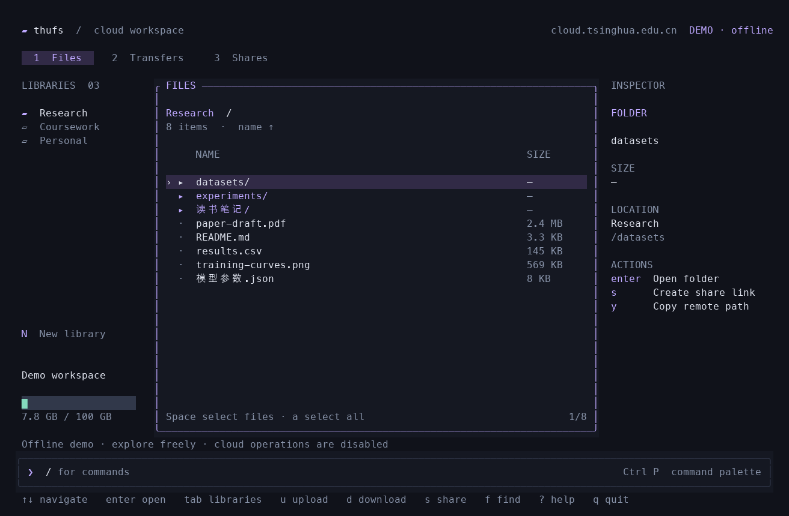
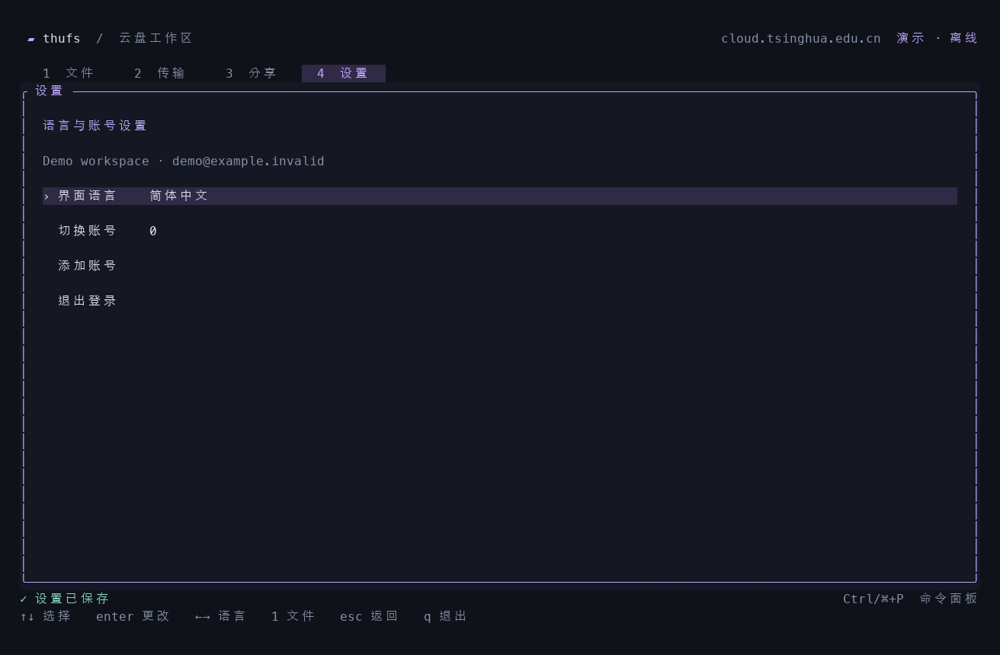
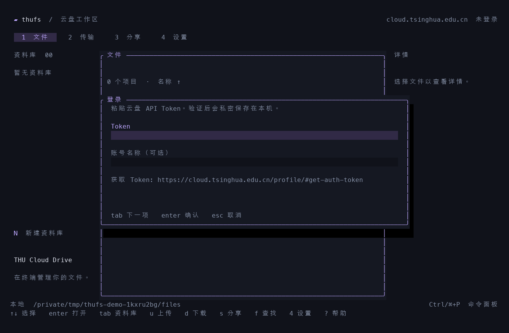
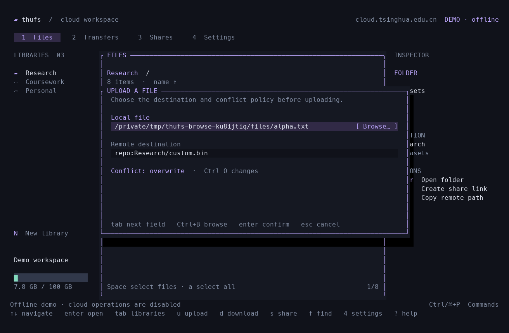
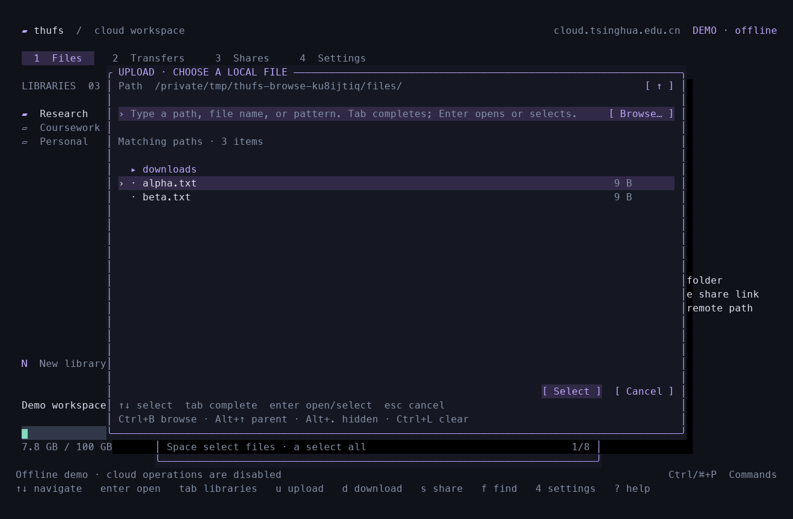
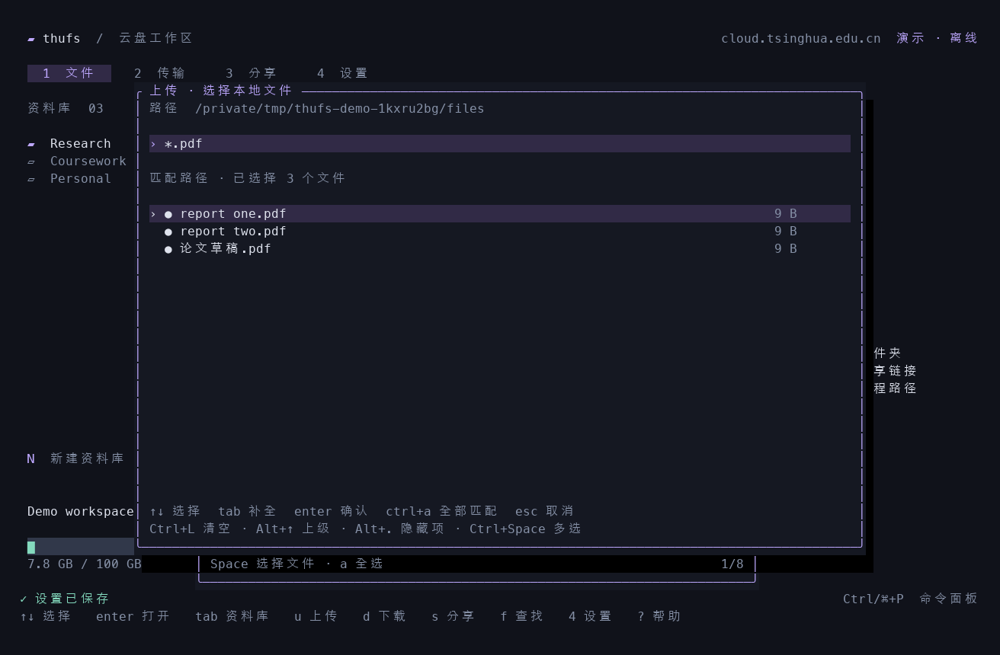
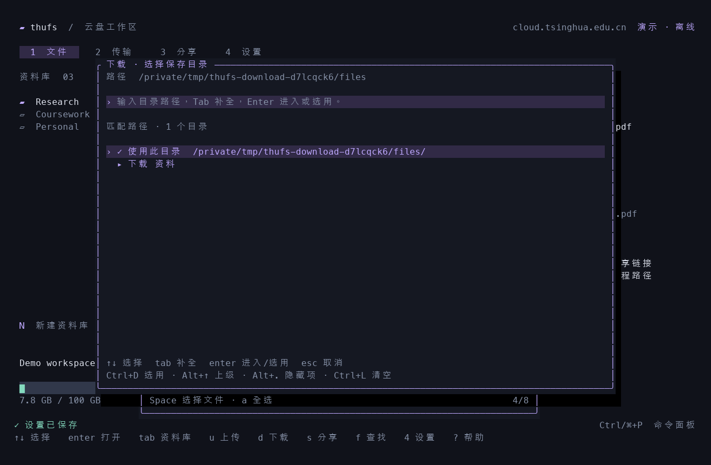

# thufs TUI

## 启动

TUI 可以直接使用已有的 thufs 配置和 `THUFS_TOKEN`。
没有可用令牌时会显示 Token 登录表单，无需先退出 TUI 执行认证命令。

```bash
thufs tui
thufs tui course-lib
thufs tui repo:course-lib/slides
thufs tui --local ~/Downloads
```

从当前源码运行：

```bash
cargo run --locked -- tui
```

未指定资料库时，优先打开配置中的默认资料库，否则打开列表中的第一个资料库。
默认从当前目录选择上传文件，下载保存目录默认为当前用户的 `~/Downloads`，不存在时自动创建。上传和下载分别记住上次使用的目录。
`--local` 必须指向已有目录，可覆盖初始上传位置和默认下载位置。

只读离线演示使用内置数据，不访问云盘，也不上传、下载或创建分享：

```bash
thufs tui --demo
```

## 工作区

顶部提供文件、传输、分享、设置和关于五个工作区。
按 `1`、`2`、`3`、`4`、`5` 切换，文件位置会保留。
鼠标单击资料库即可切换并载入文件列表。



文件工作区采用深色背景、紫色焦点和绿色状态提示。
左侧显示资料库和账号容量，中间显示目录，右侧显示所选项目的路径、体积、修改时间和可用操作。
文件详情弹窗同样显示修改时间。目录列表已有的日期会直接复用；缺失时按需查询当前项目，不为整个列表逐个请求详情。
时间统一使用上海时区（UTC+8），显示 `+08:00`；Unix 时间戳和带其他时区偏移的日期会先转换为上海时间。
底部仅显示状态消息和快捷键提示。命令面板通过快捷键唤出。
界面使用普通 Unicode 字符，无需安装 Nerd Font。

最低终端尺寸为 60 × 18。
宽度达到 90 列时并排显示资料库，达到 118 列时显示详情栏。
窄屏下按 `Tab` 打开资料库列表，选中资料库后按 `Enter` 返回文件列表。
高度不足 26 行时会压缩留白，保留文件列表空间。

## 命令面板

按 `Ctrl+P` 打开或收起命令面板。macOS 上也支持终端转发的 `Cmd+P`。
如果终端拦截了 `Cmd+P`，使用 `Ctrl+P`。
输入中文或英文的操作名称，也可以用说明中的词进行模糊匹配。
按上下键选择，`Tab` 补全，`Enter` 执行，`Esc` 关闭。


面板提供以下命令：

```text
Search      Settings    Accounts    Sign in     Sign out
Files       Upload      Download    Share
Transfers   Shares      Goto        Mkdir
Mkrepo      Refresh     Sort        Details
About       Help        Quit
Check for updates
```

## 设置、登录和账号切换

按 `4` 打开设置，顶部按“界面、网络、版本更新、账号”分类。
用 `Tab` / `Shift+Tab` 或鼠标单击切换分类，用上下键选择当前分类中的选项，按 `Enter` 更改。
“界面”包含语言；“网络”包含代理和 User-Agent；“版本更新”包含自动检测开关和手动检查；“账号”包含切换、添加或登录、退出。
语言项也可以使用左右键切换，修改后立即应用并保存。
支持 English 和简体中文；首次使用时根据 shell 的语言环境选择，之后使用保存的设置。
文件名、路径和账号名称保持原文。

设置中的 `User-Agent` 可自定义 HTTP 请求标识，按 `Enter` 编辑并保存；留空恢复默认。
默认格式为 `thufs/<版本> (+https://github.com/class-undefined/thufs)`。
修改保存在 `config.json` 的 `user_agent` 项，对之后的 TUI 请求及 CLI 上传、下载生效；正在执行的请求继续使用原值。

“代理”项可配置自动检测、手动指定和直连。用 `←` / `→` 或 `Space` 切换模式，`Tab` 进入地址栏，`Enter` 保存。
自动模式读取代理环境变量，无有效环境变量代理时使用 macOS / Windows 的系统静态 HTTP、HTTPS 代理；Linux 使用环境变量。
手动地址支持 `http://`、`https://`、`socks5://`、`socks5h://`，例如 `http://127.0.0.1:7890`。
`NO_PROXY` / `no_proxy` 可用于绕过指定目标；直连模式忽略所有代理。PAC / WPAD 脚本暂不解析。
代理配置与 CLI 共用，保存后用于后续云盘请求、上传下载和更新检测；代理认证信息会在设置列表和配置摘要中隐藏。

“关于”是与“设置”平级的独立页面，显示 ASCII logo、thufs 版本、作者和项目仓库链接；终端高度较小时使用紧凑 logo。
按 `5` 或点击顶部“关于”打开，也可按 `Ctrl+P` 搜索 `About` 或“关于”；无需登录即可查看，按 `Esc` 返回文件页。

TUI 启动时在后台检测 GitHub 最新稳定 Release，缓存结果 24 小时；设置页的“自动检测更新”可关闭启动检测，偏好保存在 `tui.json`。
关于页会显示检测状态。点击“检查更新”或按 `u` / `r` 可跳过缓存重新检测，按 `Enter` 查看版本、发布链接和更新命令，`i` 也可查看失败原因。
命令面板中的 `Check for updates` / “检查更新”可从任意工作区手动检测。
网络超时或限流只影响版本检测；演示模式不访问网络。检测使用设置中的 User-Agent，不发送云盘 Token。



未登录时会打开 Token 表单，也可以从设置中选择“使用 Token 登录”或“添加账号”。
粘贴清华云盘 API Token，可填写账号名称，然后按 `Enter` 验证。
密码式输入会隐藏 Token；验证成功后才保存并激活账号。
验证失败时保留当前账号，可以在原表单中更正 Token 后重试。
表单中提供 [Token 获取页面](https://cloud.tsinghua.edu.cn/profile/#get-auth-token) 的地址。



选择“切换账号”后，可使用已保存的账号，也可以选择环境变量或 CLI 配置中的账号。
“切换账号”旁直接显示当前用户名；未设置用户名时显示邮箱。
新账号验证成功后会清除上一账号的目录、分享和传输记录，旧请求不会覆盖新会话。
仍有传输任务时，需要先完成或取消任务，再切换或退出账号。
语言设置可以在传输期间更改。

TUI 设置和已保存的账号保存在配置目录的 `tui.json` 中，Unix 文件权限为 `0600`。
显式选择的 TUI 账号优先于 `THUFS_TOKEN`；未选择账号时，按环境变量和 CLI 配置的顺序读取。
该选择只影响 TUI，CLI 的配置文件和环境变量优先级保持原样。
“退出登录”会结束当前 TUI 会话并保持退出状态，已保存的账号仍可在列表中重新选择。

## 浏览与搜索

用方向键或 `j/k` 上下移动，按 `Enter`、右方向键或 `l` 打开资料库、目录或文件详情。
按左方向键、`h` 或退格键返回父目录。在资料库根目录执行返回操作时，焦点移到资料库列表。
返回父目录时会恢复原来的行位置。

文件列表和分享列表上方均有搜索框，可单击输入，或按 `Ctrl+F` / `f` 开始搜索。
文件页搜索当前资料库中的所有文件和目录，包含所有子目录，按名称和完整路径模糊匹配。
分享页支持按文件名、路径、资料库名、链接或分享码搜索。支持中英文、忽略大小写，也可用空格分隔多个关键词。
`Enter` 保留搜索结果并恢复快捷键，`Esc` 清除查询并返回当前目录列表；也可直接单击搜索结果后执行下载等操作。
首次整库搜索在后台读取目录，后续查询复用当前会话的缓存；按 `r` 刷新结果。

按 `Space` 选择或取消选择一个文件或目录，按 `a` 选择或取消选择所有可见项目。
同时选择目录和其子项目时，下载只保留父目录任务，避免重复下载。按 `o` 在名称升序、名称降序和体积降序之间切换；常规浏览时目录优先，搜索结果按匹配程度排序。

## 上传和下载

本地路径输入框右侧提供“浏览…”按钮。点击按钮，或在路径输入框按 `Ctrl+B` / `F4`，打开 TUI 文件对话框。
上传时选择本地文件，下载时选择保存目录。
选择器打开时会将当前目录填入路径输入框，进入子目录或返回上级时同步更新；可直接编辑该路径。
选择器和传输确认框中的本地路径均支持 `Tab` 补全：先补齐共同前缀，再补全匹配项；目录末尾自动添加分隔符，可继续补全子目录。
确认框中用 `↑` / `↓` 或 `Shift+Tab` 切换字段。



对话框支持鼠标单击选择、双击文件或目录、滚轮移动列表，以及“选择 / 选用目录”和“取消”按钮。
顶部的 `↑` 按钮返回上级。对话框内的“浏览…”按钮会按当前输入打开所在目录，显示完整列表。
路径尚未输入完整时，从最近存在的父目录开始浏览。

选择后回填路径；取消则恢复原表单，不开始传输。
重选上传文件时，默认远程文件名会跟随新文件名更新；自定义目标和冲突策略会保留。



上传时先打开目标云盘目录，再按 `u`。
路径输入框支持文件名、相对路径、绝对路径和 `~`；中文和带空格的路径可直接输入。

```text
report
../results/report.pdf
~/Downloads/论文草稿.pdf
~/Downloads/report*.pdf
```

普通文本使用前缀和模糊匹配，`*`、`?` 和 `[ab]` 使用通配符匹配。
上下键选择匹配结果，`Tab` 补全共同前缀或当前结果，`Enter` 打开目录或选择文件。
路径不正确或没有匹配结果时，可以直接继续编辑。



| 按键 | 选择器中的作用 |
| --- | --- |
| `↑` / `↓` | 选择匹配结果 |
| `Tab` | 补全路径；目录补上分隔符 |
| `Enter` | 打开目录，或进入上传确认 |
| `Ctrl+A` | 选择或取消选择全部匹配文件 |
| `Ctrl+Space` | 选择或取消选择当前文件 |
| `Ctrl+L` | 清空输入，重新输入路径 |
| `Alt+↑` | 返回当前浏览目录的父目录 |
| `Alt+.` | 切换隐藏文件；直接输入 `.` 开头的名称也能匹配隐藏文件 |
| `Esc` | 放弃选择 |

确认上传前可以检查目标和冲突策略。
单文件可以修改本地路径和远程文件名；多个文件可以统一指定远程目录。
用 `Ctrl+O` 选择冲突策略，再按 `Enter` 加入传输队列。

本地选择器支持有效的文件和目录符号链接。
选定文件后，所在目录会成为新的本地工作目录。
最多显示 2000 个匹配结果；结果更多时请缩小范围。
暂不接受 `**` 递归通配符，也不递归上传文件夹。
离线演示可以浏览本地路径并查看上传或下载确认，但不会执行传输。

下载时选中文件或目录，按 `d` 打开保存目录选择器，列表只显示目录。
可以直接输入目录路径，用 `Tab` 补全；`Enter` 进入子目录。
选择“使用此目录”并按 `Enter`，或按 `Ctrl+D` 直接选用高亮目录，再确认保存位置和冲突策略。
支持返回父目录、显示隐藏目录，以及中文和带空格的路径。按 `Esc` 取消选择，不会开始下载。



有多选项目时会逐个入队；没有多选时下载当前文件或目录。
目录下载保留完整层级和空目录，传输页显示整个目录的总进度；中断后重试会复用临时目录并尝试续传。
目录冲突默认自动改名，`overwrite` 合并并覆盖同名文件、保留无关文件，`fail` 拒绝覆盖。
下载目录必须已存在。上传和下载都默认使用 `uniquify`，重名时保存为新的文件名。
`Ctrl+O` 可改为 `overwrite` 或 `fail`。

传输工作区显示方向、目标、进度、体积、速度和结果。
任务逐个执行，等待期间可以继续浏览、筛选和查看分享。

| 按键 | 作用 |
| --- | --- |
| `x` | 取消当前任务或尚未开始的任务 |
| `r` | 重试失败或已取消的任务 |
| `Enter` | 查看结果、实际保存路径或完整错误 |
| `Shift+C` | 清除已结束的任务记录 |

重名处理后的实际路径会保存在任务详情中。
退出时若仍有传输，界面会先要求确认，再取消剩余任务。
部分下载保留 `.thufs-part` 文件，重试时按现有 CLI 规则尝试续传。
传输队列保存在当前会话内，退出后不会恢复排队记录。

## 分享和创建目录

选中文件或目录后按 `s` 创建分享。
密码可留空，默认有效期为 7 天；清空有效期表示不设置到期时间。
密码输入显示为圆点。按 `Tab` 切换输入框，`Enter` 确认，`Esc` 放弃。
创建完成后，按 `y` 或 `Enter` 复制链接。

分享工作区列出文件路径、链接、所属资料库、访问次数和到期时间。
选中分享文件或分享目录后按 `d` 下载，也可在 `Enter` 打开的详情中按 `d`。
下载会先选择本地目录并确认，再加入传输队列；分享目录同样保留目录结构。
按 `y` 复制选中链接，按 `x` 打开撤销确认，再按 `Enter` 撤销。
撤销只移除分享链接，云盘文件仍然保留。

文件工作区中，`n` 创建目录，`N` 创建资料库，`g` 跳转到指定路径。
目录名可以包含相对的多级路径，如 `results/november`。

## 快捷键

| 按键 | 作用 |
| --- | --- |
| `1` / `2` / `3` / `4` / `5` | 文件 / 传输 / 分享 / 设置 / 关于 |
| `Ctrl+P` / 可转发的 `Cmd+P` | 打开或收起命令面板 |
| `↑` / `↓`、`j` / `k` | 移动光标 |
| `Enter` / `→` / `l` | 打开项目或查看详情 |
| `←` / `h` / 退格键 | 父目录或资料库列表 |
| `Tab` | 切换资料库和文件焦点；表单中切换输入框 |
| `Home` / `End`、`PgUp` / `PgDn` | 首尾跳转、翻页 |
| `Ctrl+F` / `f` | 聚焦列表上方的搜索框；整库或分享链接模糊搜索 |
| `Space` / `a` | 单个文件多选 / 全部可见文件多选 |
| `u` / `d` / `s` | 上传 / 下载 / 创建分享 |
| `n` / `N` / `g` | 新建目录 / 新建资料库 / 跳转路径 |
| `o` / `i` / `y` | 切换排序 / 显示详情栏 / 复制路径或链接 |
| `r` | 刷新列表；传输工作区中重试任务 |
| `?` / `F1` | 查看帮助，帮助页可用上下键滚动 |
| `Esc` | 关闭弹窗；文件列表中清除筛选和多选 |
| `q` / `Ctrl+C` | 退出；有传输时先确认 |

输入框支持中文、组合字符、emoji 和终端粘贴。
普通表单中，`Ctrl+A/E` 移到行首或行尾；`Ctrl+U/K` 删除光标前或后的内容，`Ctrl+W` 删除前一个词。
初次上传选择器中的 `Ctrl+A` 用于全选匹配文件，编辑路径时可用 `Home` 移到行首。
从单文件确认表单的“浏览…”进入时，只选择一个文件。

主工作区和文件对话框支持鼠标单击选择、双击打开和滚轮移动列表。
点击工作区标签可以切换页面；文件对话框打开时，鼠标操作只作用于对话框。
需要用鼠标选择终端文字时，可关闭鼠标捕获：

```bash
thufs tui --no-mouse
```

非空的 `NO_COLOR` 会停用配色，并用反色标识所选项目，保留终端本身的前景色和背景色。
macOS 使用 `pbcopy` 复制，Windows 使用 `clip`，Linux 依次尝试 `wl-copy`、`xclip` 和 `xsel`。
没有剪贴板工具的 SSH 环境可通过 `--no-mouse` 选取链接文字。

## 设计参考与实现

本次设计从几个终端应用中选取交互模式，并按云盘工作流重新组织：

| 参考 | 本项目采用的方式 |
| --- | --- |
| [Codex 命令弹窗](https://github.com/openai/codex/blob/main/codex-rs/tui/src/bottom_pane/command_popup.rs) | 快捷键唤出的操作列表、名称和说明并列展示 |
| [Yazi 导航](https://yazi-rs.github.io/docs/quick-start/) | 方向键和 Vim 键位并存，进入目录、返回父目录和多选操作 |
| [Lazygit 快捷键](https://github.com/jesseduffield/lazygit/blob/master/docs/keybindings/Keybindings_en.md) | 根据当前工作区展示操作提示，确认后执行会改变远程状态的操作 |
| [Ratatui 渲染](https://ratatui.rs/concepts/rendering/) | 状态驱动的界面绘制，将网络等待与输入循环分开 |

代码将终端生命周期、状态与事件、后台操作、绘制、输入编辑、账号设置和路径匹配分开。
资料库、目录和分享读取在后台线程执行，请求编号用于丢弃旧目录的延迟响应。
后台操作最多同时执行 4 个，尚未开始的同类读取只保留最新请求。
账号切换还会递增会话代次，丢弃旧账号的延迟响应。令牌通过会话参数传给服务，通过子进程环境传给传输，不修改全局环境。
TUI 中的元数据 HTTP 请求设置 30 秒超时，连接超时为 10 秒。

传输启动同一 thufs 可执行文件，使用 `--json` 和 `--progress jsonl` 读取结果和进度。
因此传输继续采用既有服务层的冲突、续传和路径规则。
取消时终止并回收子进程。正常退出、错误和 panic 路径都会恢复终端模式。

本次实现保留原有 CLI 入口和 JSON 合约。
TUI 需要交互式 stdin、stdout 和支持光标控制的终端，不接受 `--json`。
文件详情仅展示元数据；当前不支持递归目录上传、文件内容预览和跨会话队列恢复。
下载使用 CLI 默认的单线程模式，需要指定并发模式时可使用 `thufs download --mode parallel`。

路径匹配使用 [glob 的匹配规则](https://docs.rs/glob/latest/glob/fn.glob_with.html)。
修饰键读取使用 [Crossterm 的键盘增强协议](https://docs.rs/crossterm/0.28.1/crossterm/event/struct.PushKeyboardEnhancementFlags.html)，启动和退出时成对设置与恢复。
