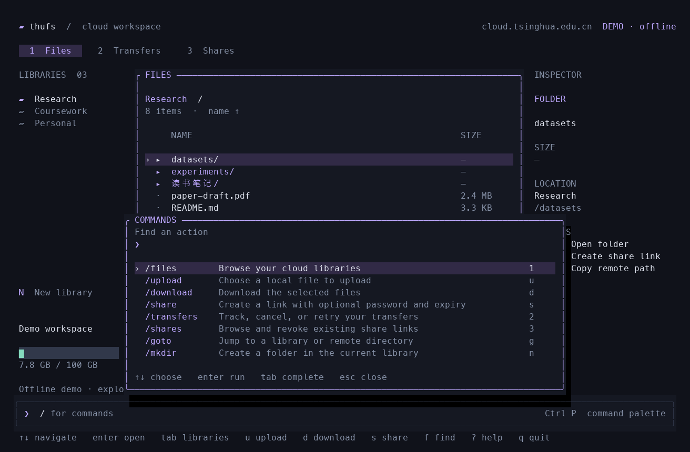

# thufs TUI

## 启动

TUI 使用已有的 thufs 配置和 `THUFS_TOKEN`，无需再次登录。
如果令牌在 shell 配置文件中设置，先在当前终端加载该文件。

```bash
thufs tui
thufs tui course-lib
thufs tui repo:course-lib/slides
thufs tui --local ~/Downloads
```

从当前源码运行：

```bash
cargo run --locked -- tui
```

未指定资料库时，优先打开配置中的默认资料库，否则打开列表中的第一个资料库。
`--local` 必须指向已有目录，作为初始上传位置和默认下载位置。

只读离线演示使用内置数据，不访问云盘，也不上传、下载或创建分享：

```bash
thufs tui --demo
```

## 工作区

顶部的 `Files`、`Transfers` 和 `Shares` 分别对应文件、传输和分享。
按 `1`、`2`、`3` 切换，文件位置会保留。


文件工作区采用深色背景、紫色焦点和绿色状态提示。
左侧显示资料库和账号容量，中间显示目录，右侧显示所选项目的路径、体积和可用操作。
底部固定保留命令入口、状态消息和当前快捷键。
界面使用普通 Unicode 字符，无需安装 Nerd Font。

最低终端尺寸为 60 × 18。
宽度达到 90 列时并排显示资料库，达到 118 列时显示详情栏。
窄屏下按 `Tab` 打开资料库列表，选中资料库后按 `Enter` 返回文件列表。
高度不足 26 行时会压缩留白，保留文件列表空间。

## 命令面板

按 `/`、`:` 或 `Ctrl+P` 打开命令面板。
输入操作名称或说明中的词，使用模糊匹配查找操作。
按上下键选择，`Tab` 补全，`Enter` 执行，`Esc` 关闭。



面板提供以下命令：

```text
/files      /upload     /download    /share
/transfers  /shares     /goto        /mkdir
/mkrepo     /refresh    /sort        /details
/help       /quit
```

## 浏览与筛选

用方向键或 `j/k` 上下移动，按 `Enter`、右方向键或 `l` 打开资料库、目录或文件详情。
按左方向键、`h` 或退格键返回父目录。在资料库根目录执行返回操作时，焦点移到资料库列表。
返回父目录时会恢复原来的行位置。

按 `f` 筛选当前目录或分享列表，支持中文和模糊匹配。
`Enter` 保留筛选结果并恢复快捷键，`Esc` 清除筛选和文件多选。
筛选只作用于当前列表，不递归搜索整个资料库。

按 `Space` 选择或取消选择一个文件，按 `a` 选择或取消选择所有可见文件。
目录不参与文件多选。按 `o` 在名称升序、名称降序和体积降序之间切换，目录始终排在文件前面。

## 上传和下载

上传时先打开目标云盘目录，再按 `u`：

1. 在本地选择器中选择文件。`Enter` 打开目录，`h` 返回父目录，`.` 切换隐藏文件。
2. 检查本地路径和远程目标，可直接修改两个输入框。
3. 用 `Ctrl+O` 选择冲突策略，按 `Enter` 加入传输队列。

本地选择器支持指向普通文件或目录的有效符号链接。
选定上传文件后，所在目录会成为新的本地工作目录。

下载时选中文件，按 `d`，检查保存目录后确认。
有多选文件时会逐个入队；没有多选时下载当前文件。
下载目录必须已存在。上传和下载都默认使用 `uniquify`，重名时保存为新的文件名。
`Ctrl+O` 可改为 `overwrite` 或 `fail`。

传输工作区显示方向、目标、进度、体积、速度和结果。
任务逐个执行，等待期间可以继续浏览、筛选和查看分享。

| 按键 | 作用 |
| --- | --- |
| `x` | 取消当前任务或尚未开始的任务 |
| `r` | 重试失败或已取消的任务 |
| `Enter` | 查看结果、实际保存路径或完整错误 |
| `C` | 清除已结束的任务记录 |

重名处理后的实际路径会保存在任务详情中。
退出时若仍有传输，界面会先要求确认，再取消剩余任务。
部分下载保留 `.thufs-part` 文件，重试时按现有 CLI 规则尝试续传。
传输队列保存在当前会话内，退出后不会恢复排队记录。

## 分享和创建目录

选中文件或目录后按 `s` 创建分享。
密码可留空，默认有效期为 7 天；清空有效期表示不设置到期时间。
密码输入显示为圆点。按 `Tab` 切换输入框，`Enter` 确认，`Esc` 放弃。
创建完成后，按 `y` 或 `Enter` 复制链接。

分享工作区列出文件路径、链接、所属资料库、访问次数和到期时间。
按 `y` 复制选中链接，按 `x` 打开撤销确认，再按 `Enter` 撤销。
撤销只移除分享链接，云盘文件仍然保留。

文件工作区中，`n` 创建目录，`N` 创建资料库，`g` 跳转到指定路径。
目录名可以包含相对的多级路径，如 `results/november`。

## 快捷键

| 按键 | 作用 |
| --- | --- |
| `1` / `2` / `3` | 文件 / 传输 / 分享 |
| `/` / `:` / `Ctrl+P` | 命令面板 |
| `↑` / `↓`、`j` / `k` | 移动光标 |
| `Enter` / `→` / `l` | 打开项目或查看详情 |
| `←` / `h` / 退格键 | 父目录或资料库列表 |
| `Tab` | 切换资料库和文件焦点；表单中切换输入框 |
| `Home` / `End`、`PgUp` / `PgDn` | 首尾跳转、翻页 |
| `f` | 筛选当前列表 |
| `Space` / `a` | 单个文件多选 / 全部可见文件多选 |
| `u` / `d` / `s` | 上传 / 下载 / 创建分享 |
| `n` / `N` / `g` | 新建目录 / 新建资料库 / 跳转路径 |
| `o` / `i` / `y` | 切换排序 / 显示详情栏 / 复制路径或链接 |
| `r` | 刷新列表；传输工作区中重试任务 |
| `?` / `F1` | 查看帮助，帮助页可用上下键滚动 |
| `Esc` | 关闭弹窗；文件列表中清除筛选和多选 |
| `q` / `Ctrl+C` | 退出；有传输时先确认 |

输入框支持中文、组合字符、emoji 和终端粘贴。
`Ctrl+A/E` 移到行首或行尾，`Ctrl+U/K` 删除光标前或后的内容，`Ctrl+W` 删除前一个词。

主工作区支持鼠标单击选择、双击打开、点击工作区标签和滚轮移动列表。
需要用鼠标选择终端文字时，可关闭鼠标捕获：

```bash
thufs tui --no-mouse
```

非空的 `NO_COLOR` 会停用配色，并用反色标识所选项目，保留终端本身的前景色和背景色。
macOS 使用 `pbcopy` 复制，Windows 使用 `clip`，Linux 依次尝试 `wl-copy`、`xclip` 和 `xsel`。
没有剪贴板工具的 SSH 环境可通过 `--no-mouse` 选取链接文字。

## 设计参考与实现

本次设计从几个终端应用中选取交互模式，并按云盘工作流重新组织：

| 参考 | 本项目采用的方式 |
| --- | --- |
| [Codex 命令弹窗](https://github.com/openai/codex/blob/main/codex-rs/tui/src/bottom_pane/command_popup.rs) | 底部命令入口、可搜索的操作列表、名称和说明并列展示 |
| [Yazi 导航](https://yazi-rs.github.io/docs/quick-start/) | 方向键和 Vim 键位并存，进入目录、返回父目录和多选操作 |
| [Lazygit 快捷键](https://github.com/jesseduffield/lazygit/blob/master/docs/keybindings/Keybindings_en.md) | 根据当前工作区展示操作提示，确认后执行会改变远程状态的操作 |
| [Ratatui 渲染](https://ratatui.rs/concepts/rendering/) | 状态驱动的界面绘制，将网络等待与输入循环分开 |

代码按职责分为终端生命周期、状态与事件、后台操作、绘制和输入编辑五部分。
资料库、目录和分享读取在后台线程执行，请求编号用于丢弃旧目录的延迟响应。
后台操作最多同时执行 4 个，尚未开始的同类读取只保留最新请求。
TUI 中的元数据 HTTP 请求设置 30 秒超时，连接超时为 10 秒。

传输启动同一 thufs 可执行文件，使用 `--json` 和 `--progress jsonl` 读取结果和进度。
因此传输继续采用既有服务层的冲突、续传和路径规则。
取消时终止并回收子进程。正常退出、错误和 panic 路径都会恢复终端模式。

本次实现保留原有 CLI 入口和 JSON 合约。
TUI 需要交互式 stdin、stdout 和支持光标控制的终端，不接受 `--json`。
文件详情仅展示元数据；当前不支持递归目录传输、文件内容预览和跨会话队列恢复。
下载使用 CLI 默认的单线程模式，需要指定并发模式时可使用 `thufs download --mode parallel`。
